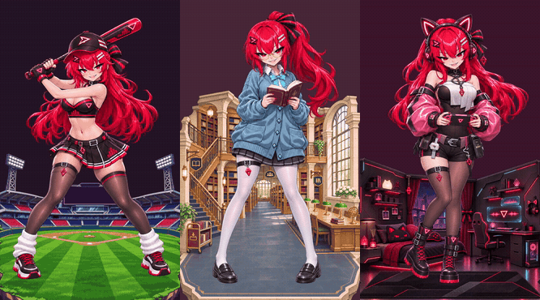

# Live2D Character Workflow

[](https://eastpeak001.github.io/live2d-character-workflow/)

**[▶ 在线观看三个完整视频](https://eastpeak001.github.io/live2d-character-workflow/)**

| 棒球 · Getting it Done | 阅读 · Wallpaper | 掌机 · Digital Lemonade |
| :--- | :--- | :--- |
| [棒球场 · 1.5× · 11.33 秒](examples/getting-it-done.mp4) | [图书馆 · 1.3× · 13.85 秒](examples/wallpaper.mp4) | [游戏房 · 1× · 14.92 秒](examples/digital-lemonade.mp4) |

这套工作流从角色立绘制作可继续编辑的 Live2D 模型和动画。作者在 Cubism 工程中调整重心、分开控制手与道具、校正眼神和发梢，再将正式动画的透明帧叠到场景上。上方三段视频均为 864 × 1440、60 fps。

## 获取技能包

**[下载 v1.0.0 技能包](https://github.com/eastpeak001/live2d-character-workflow/releases/download/v1.0.0/live2d-character-workflow-v1.0.0.zip)** · [浏览技能说明](skills/live2d-character-workflow/SKILL.md) · [分步练习](skills/live2d-character-workflow/references/tools.md)

压缩包内只有一个 `live2d-character-workflow` 文件夹。保留它的名字，按你使用的工具选择位置。

| 使用方式 | 放在哪里或怎样开始 |
| --- | --- |
| 支持 Agent Skills 的助手 | 将整个文件夹放入该工具支持的技能目录。入口为 `SKILL.md`。 |
| Codex | 项目内使用 `.agents/skills/live2d-character-workflow/`。 |
| Claude Code | 项目内使用 `.claude/skills/live2d-character-workflow/`，在会话中输入 `/live2d-character-workflow`。 |
| 独立使用 | 在技能文件夹运行下方 Python 命令，用 Cubism 打开和编辑结果。 |

[Agent Skills 格式规范](https://agentskills.io/specification) · [Claude Code 技能目录](https://code.claude.com/docs/en/skills)

## 用一个原创纸吊饰试跑

**[下载可直接在 Cubism 打开的练习工程](https://github.com/eastpeak001/live2d-character-workflow/releases/download/v1.0.0/paper-mobile-cubism-v1.0.0.zip)**。解压后打开 `Swing.can3` 播放和调整关键帧，打开 `Mobile.cmo3` 调整模型，或用图像编辑器打开 `Mobile.psd` 查看分层。下方命令从头生成同一个练习。

安装 Python 3.10 或更高版本。进入技能文件夹后运行以下命令。练习会生成三层 PSD、两个独立的父子摆动参数和一段两秒循环。此练习素材也按 MIT 授权。

```sh
python -m pip install -r requirements.txt
python scripts/starter.py practice
```

双击 `practice/Swing.can3`，在 Cubism 播放两秒的悬绳与坠饰循环，展开模型轨道就能移动关键帧。打开 `practice/Mobile.cmo3` 可以分别调整悬绳和坠饰的幅度。真实角色从自己的分层 PSD 开始，在 Cubism 中保存中性模型，再替换本例的参数、支点和曲线。[角色制作与验收](skills/live2d-character-workflow/references/art-and-motion.md)

## 可复用的环节

| 需要完成的工作 | 对应入口 |
| --- | --- |
| 将对齐好的透明图层、补画或蒙版合成分层 PSD | [layers_psd.py](skills/live2d-character-workflow/scripts/layers_psd.py) |
| 为新导入的模型建立分层变形器、支点和独立参数 | [bind_model.py](skills/live2d-character-workflow/scripts/bind_model.py) |
| 将按帧编写的动作曲线导入 Cubism 时间线 | [motion_keys.py](skills/live2d-character-workflow/scripts/motion_keys.py) |
| 把动作配方写成可直接打开的原生动画工程 | [animate.py](skills/live2d-character-workflow/scripts/animate.py) |
| 透明角色帧叠加背景、指定倍速并导出 MP4 | [compose.py](skills/live2d-character-workflow/scripts/compose.py) |

遮挡补画、细部网格和动作质量需要制作人结合姿势判断。在官方 Cubism Editor 里可继续改模型参数、动作时间线和关键帧。

## Licensing

The workflow code, instructions and geometric practice assets are MIT licensed. All rights to the three showcase characters, backgrounds, movies, posters and gallery animation are reserved by their respective rights holders. [MIT license](LICENSE) · [演示素材授权范围](examples/RIGHTS.md) · [第三方声明](skills/live2d-character-workflow/THIRD_PARTY.md)
